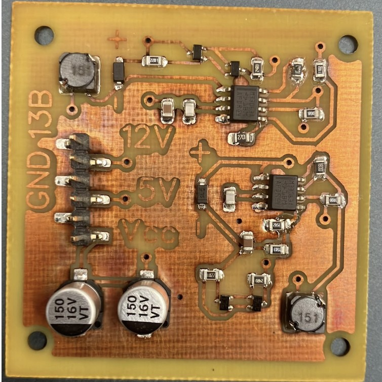
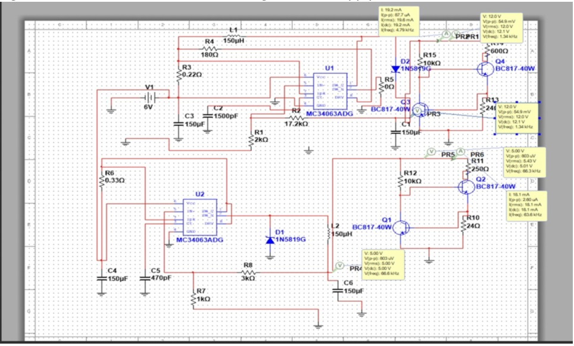
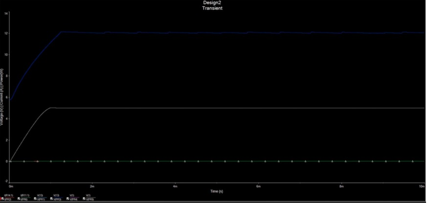
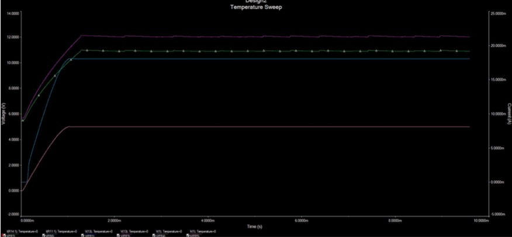
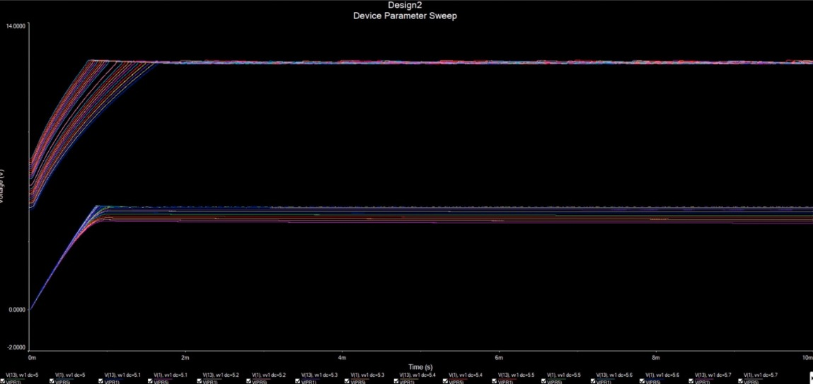

# Dual-Output 5 V and 12 V DC-DC Power Supply

A dual-output power supply developed for an Antarctic weather-station design brief. Two MC34063A converters generate regulated 5 V and 12 V rails from a single 6 V nominal battery input, with discrete output-current limiting.

[View the full interactive project page](https://zceeamt.github.io/#power-supply)



## Project context and role

This was an intensive group design project responding to a customer specification. I was responsible for the circuit design and Multisim simulation; the team fabricated, debugged, verified and documented the hardware. The final nine-document design portfolio received **80% (first-class level)**.

## Requirements

The customer required the design to:

- Produce regulated 5 V and 12 V outputs from one battery.
- Withstand storage at -40 °C and operate from 0 °C to 70 °C.
- Exceed 60% efficiency at a 20 mA load on either output.
- Limit short-circuit current to 30 mA per output.
- Maintain regulation with the input voltage ±20% from nominal.
- Weigh no more than 25 g.

## Converter design

The two outputs use independent MC34063A switching-regulator stages:

- A **boost converter** raises 6 V to 12 V.
- A **buck converter** reduces 6 V to 5 V.
- Each stage uses a 150 µH inductor and 1N5819 Schottky diode.
- Low-value sense resistors limit the peak switching current.
- Output capacitors smooth the switching waveform.

The feedback dividers set the nominal rails using:

```text
Vout = 1.25 × (1 + Rupper / Rlower)

12 V rail: 1.25 × (1 + 17.2 kΩ / 2 kΩ) ≈ 12.0 V
 5 V rail: 1.25 × (1 + 3 kΩ / 1 kΩ) = 5.0 V
```



## Output-current limiting

Each rail includes a discrete limiter using BC817 transistors and a 24 Ω sense resistor. As the sense voltage approaches approximately 0.6 V, the control transistor diverts base drive from the pass device:

```text
Ilimit ≈ 0.6 V / 24 Ω ≈ 25 mA
```

This keeps the output below the customer's 30 mA short-circuit limit.

## Simulation and verification

Multisim was used for transient, temperature and input-voltage analysis.

- Both outputs reached regulation in approximately 1.2 ms.
- The simulated 12 V rail showed roughly 55 mV peak-to-peak ripple at a 20 mA load.
- The simulated 5 V rail showed less than 1 mV peak-to-peak ripple.
- Temperature sweeps assessed operation across the specified range.
- Input sweeps identified the 5 V buck stage's minimum-headroom region.

| Start-up transient | Temperature sweep |
|---|---|
|  |  |



## Engineering documentation

The team compared multiple assembled boards using a weighted decision matrix and verified the selected design against the specification. The final portfolio included:

- Refined requirements specification
- Project plan
- Decision matrix
- Risk register
- Verification report
- Manufacturing test procedure
- Product datasheet
- Production costing at quantities of 1 and 200

The portfolio competed with 22 other teams for a proposed 200-unit production order. The product datasheet was specifically commended for its presentation.

## Technical summary

| Item | Specification |
|---|---|
| Input | Single battery, 6 V nominal |
| Outputs | 5 V and 12 V |
| Converters | MC34063A buck and boost stages |
| Magnetics | 150 µH inductors |
| Rectifiers | 1N5819 Schottky diodes |
| Current limiting | BC817 limiter per output, approximately 25 mA |
| Simulated ripple | About 55 mV p-p at 12 V; under 1 mV p-p at 5 V |
| Simulated start-up | Approximately 1.2 ms |
| Tools | Multisim, soldering and bench testing |
| Result | Hardware built and verified; portfolio graded 80% |

## Skills demonstrated

DC-DC converters, buck and boost design, current limiting, Multisim, datasheet analysis, requirements engineering, verification, technical writing and multidisciplinary teamwork.
